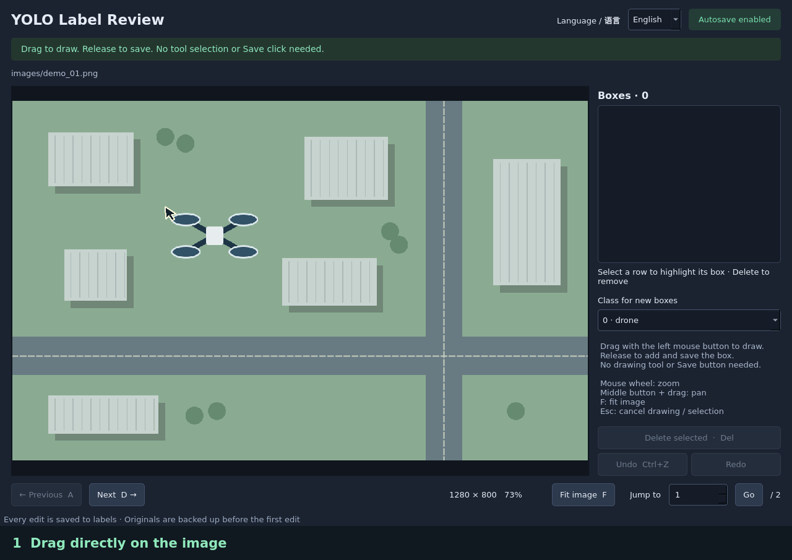

# YOLO Label

English | [简体中文](README.zh-CN.md)

**Drag a box. Release to save.**

A desktop tool for reviewing YOLO object detection annotations. Draw missing boxes directly on the image with the left mouse button. Every change saves automatically: there is no drawing-tool button to activate and no Save button to click.



*Recorded in the application using real dataset images: draw, release to save, then press D for the next image. The walkthrough uses copies to demonstrate adding a missing box; original annotations are preserved.*

## Start reviewing in three steps

| What you see | What you do | What happens |
| --- | --- | --- |
| A missing box | Hold the left mouse button, drag around the object, and release | The new box is saved immediately |
| An incorrect box | Click its row on the right, then press **Delete** | The selected box is highlighted; deleting it saves immediately |
| Ready for the next image | Press **D**; use **A** to go back | Hold either key to keep browsing; release to stop |

**Just draw → release → continue.** You can also start a new box inside an existing one. For a dataset with multiple classes, choose the class in the right sidebar before drawing; that choice is reused for subsequent boxes. Press **Ctrl+Z** to undo an edit on the current image.

## Features

- English and Simplified Chinese UI, switchable without reopening the dataset.
- Hold **A** or **D** to browse backward or forward; release to stop.
- Select a box in the sidebar to highlight it, then press **Delete** to remove it.
- Drag with the left mouse button to add a box, including inside overlapping boxes.
- Immediate saves, original label backups, and undo/redo for the current image.
- Zoom, pan, jump to an image, and resume the last viewed image.
- Preserve class names and YOLO normalized coordinates. No model inference is required.

## Install

Requires Python **3.10+**, PyQt5, and a graphical desktop. Linux, Windows, and macOS can run PyQt5; local validation was performed on Linux. CI checks Python 3.10 and 3.12 on Linux.

### Get the code

On the [repository page](https://github.com/t239573445/yolo-label-review), select **Code → Download ZIP** and extract it, or clone the repository:

```bash
git clone https://github.com/t239573445/yolo-label-review.git
cd yolo-label-review
```

### Install once

Open a terminal in the extracted or cloned project folder.

**Linux / macOS**

```bash
python3 -m venv .venv
source .venv/bin/activate
python -m pip install .
```

**Windows PowerShell**

```powershell
py -3 -m venv .venv
.\.venv\Scripts\python.exe -m pip install .
```

The install command also installs PyQt5. No GPU, model weights, or model inference service is needed. This project is not published to PyPI; install from the downloaded project folder as shown above.

## Run

Replace the example path with your own dataset folder, containing `images/` and `labels/`.

**Linux / macOS** (activate the same environment again when opening a new terminal):

```bash
source .venv/bin/activate
yolo-review "/path/to/dataset" --lang en
```

**Windows PowerShell** (from the project folder):

```powershell
.\.venv\Scripts\yolo-review.exe "D:\datasets\my-dataset" --lang en
```

Use `--lang zh` for Chinese. Once the image appears, drag to add a box and release to save it. Every addition, deletion, undo, and redo is saved automatically.

With the virtual environment activated, the equivalent module command is `python -m yolo_review "/path/to/dataset"`. If no path is provided, the current working directory is used. Paths containing spaces must be quoted. For a source checkout, `python review_annotations.py "/path/to/dataset"` also works after installing the dependencies in `requirements.txt`.

Use the **Language / 语言** selector at the top of the window to change language. The default `--lang auto` uses the dataset's saved language, then the system locale (Chinese for Chinese locales, English otherwise). An explicit `--lang en` or `--lang zh` takes precedence. Class names are never translated.

`yolo-review --help`, `yolo-review --lang zh --help`, and `yolo-review --version` work without opening a window.

## Dataset layout

```text
dataset/
├── images/
│   ├── frame001.png
│   └── train/frame002.jpg
├── labels/
│   ├── frame001.txt
│   └── train/frame002.txt
└── classes.txt
```

Images are discovered recursively in natural filename order. Labels match image paths relative to `images/`, with the extension changed to `.txt` under `labels/`. Supported image extensions are PNG, JPG/JPEG, BMP, WebP, and TIF/TIFF, subject to the installed Qt image plugins. `classes.txt` is UTF-8 with one class name per line, starting at class ID 0. Missing class names are shown as numeric class IDs with a localized label. The tool reads these folders directly and does not follow paths or split definitions in `data.yaml`.

Each label line must contain exactly:

```text
class_id x_center y_center width height
0 0.500000 0.500000 0.200000 0.100000
```

Coordinates are normalized to 0–1; sizes must be positive. This tool handles axis-aligned detection rectangles, not segmentation, pose, or oriented boxes. Missing labels load as empty and are created on the first edit. Deleting the last box leaves an empty label file. Malformed labels disable editing for that image and display an error instead of silently discarding data.

## Controls

| Action | Control |
| --- | --- |
| Previous / next image | A / D; hold to repeat using the OS keyboard repeat rate |
| Select and highlight | Click a row in the right sidebar |
| Delete selected box | Delete |
| Add box | Left mouse button + drag; release to save |
| Correct a box | Delete it and draw its replacement |
| Undo / redo | Ctrl+Z / Ctrl+Shift+Z or Ctrl+Y |
| Zoom / pan | Mouse wheel / middle mouse button + drag |
| Fit image | F |
| Cancel drawing / selection | Esc |
| Jump | Enter a 1-based image number, then Enter or Go |

Undo history is cleared when changing images. A drag must cover at least two source-image pixels in each dimension to create a box. Green boxes are existing labels, yellow marks the selection, and blue outlines the box being drawn.

## Saving and recovery

Every add, delete, undo, and redo writes the corresponding label file through a temporary file and atomic replacement. The UI only applies the edit after a successful save. Only one application window may edit the same dataset at a time. Revision checks detect label changes made by other programs; navigate away and back to reload after a conflict. This is not a multi-user annotation server.

Before the first edit to a label, its original contents are backed up to `.yolo_review/backups/labels/` with the same relative path. Subsequent edits do not replace that original backup. To restore it, close the reviewer and copy the backup over the matching file in `labels/`. A `.txt.missing` marker means no label originally existed; remove the newly created label file to restore that state.

`.yolo_review/state.json` stores position and language. Opening images, selecting boxes, and changing language do not rewrite labels. Automatic review backups are local to the dataset; copy them with the dataset if needed.

## Development

GitHub Actions runs checks on pushes and pull requests. All automated tests use temporary synthetic datasets.

Dataset images, labels, model files, local backups, environments, and build artifacts are excluded by `.gitignore`. Share the project source separately from your datasets.

## License

The project source is available under the [MIT License](LICENSE). Dependencies keep their own licenses: PyQt5 is provided under GPL v3 or a commercial license; this project's MIT license does not replace PyQt5's terms.
